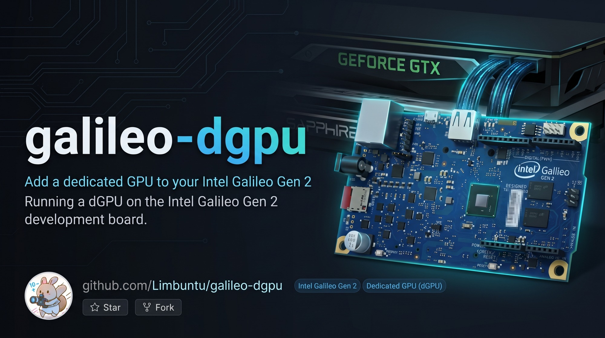
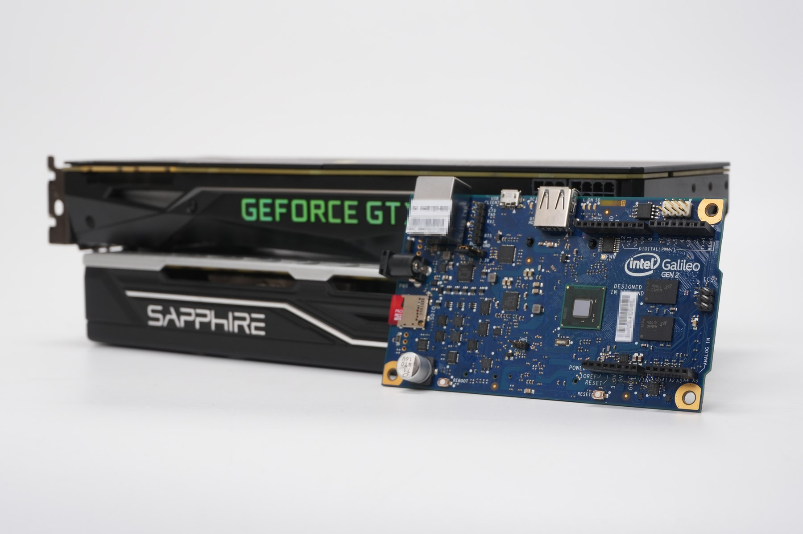
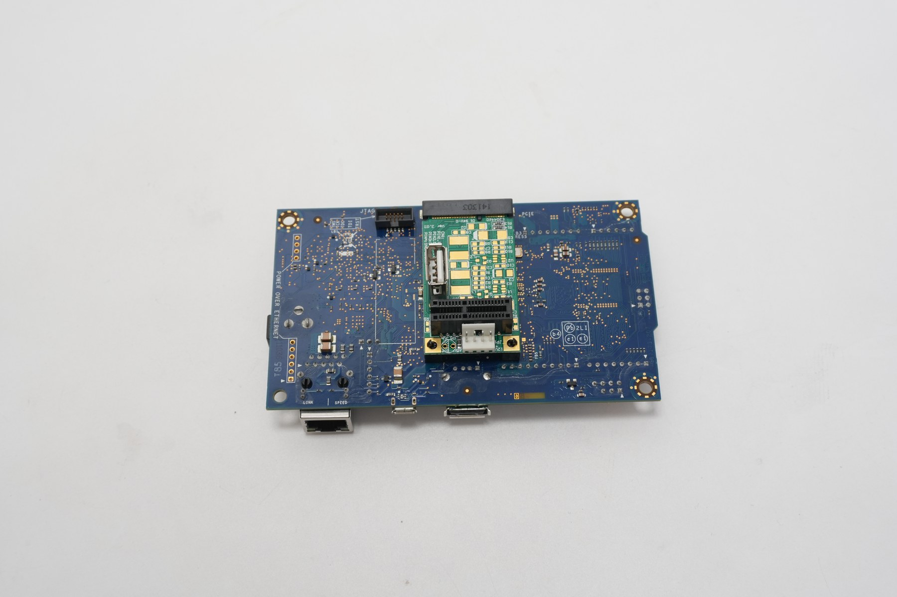
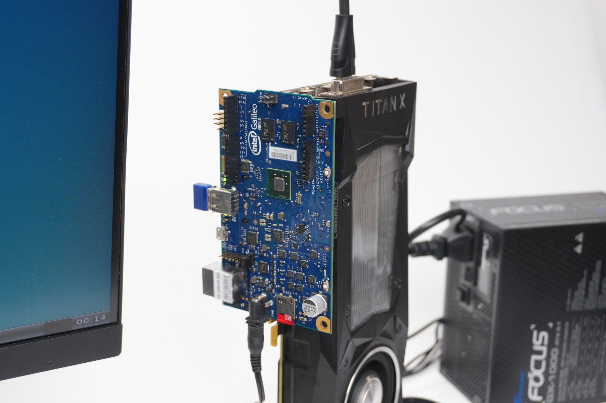
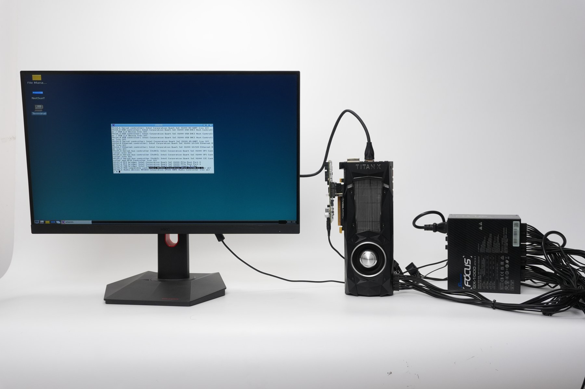
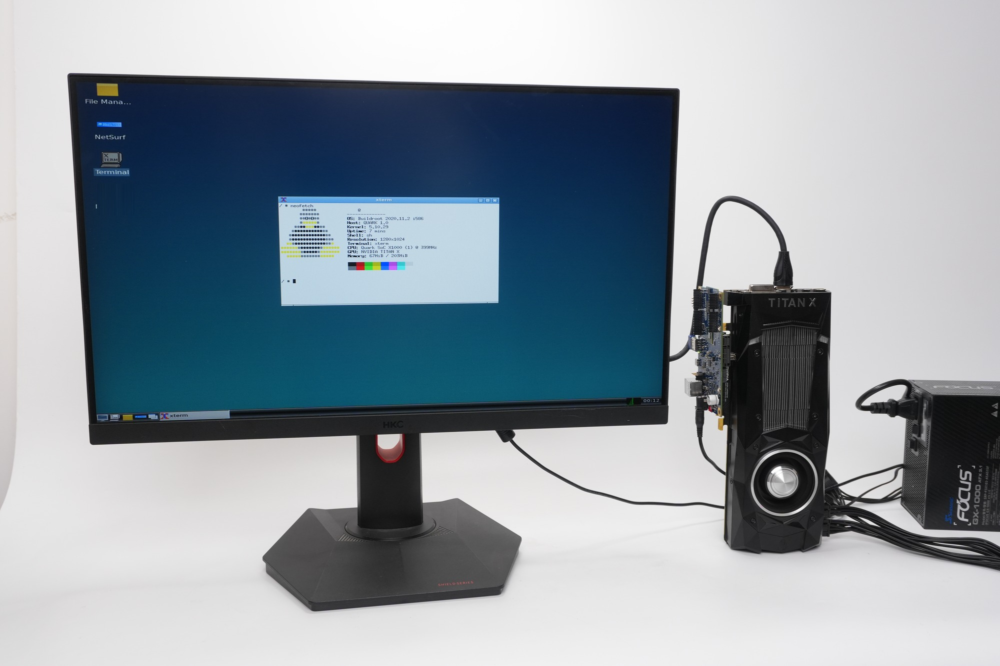

# Galileo Gen 2 — Discrete GPU Rebuild Project

[中文文档](README.zh-CN.md)

[](docs/galileo/hero.jpg)

Reviving an Intel Galileo Gen 2 (Quark X1000, 400 MHz i586, 256 MB RAM, no SSE2/PAE/CMOV)
as a fully usable Linux computer: LXDE desktop, GPU acceleration, 4K video decode,
and a browser — with any one of three discrete GPUs driving the display.

## Image Lineup

Two images. One defconfig, one overlay layer, standard names.

| defconfig | Image | Contents | Rootfs |
|---|---|---|---|
| `galileo_desktop` | desktop | X + openbox + pcmanfm + the GPU media stack (VA-API/UVD 4K decode, mpv, ffplay) | 3000M |
| `galileo_workstation` | workstation | desktop + NetSurf + OpenTTD/Doom/OpenArena + glmark2/gtkperf/mesa-demos | 3000M |

Naming convention — do not invent new suffixes:

| Layer | Path |
|---|---|
| common | `board/intel/galileo/rootfs_overlay_common` |
| desktop | `board/intel/galileo/rootfs_overlay_desktop` (X session, shared by desktop + workstation) |
| workstation | `board/intel/galileo/rootfs_overlay_workstation` (apps/bench extras on top of desktop) |

Two remotes, two histories. `buildserver` (Gitea, private) keeps the full tree;
`github` gets a filtered export through `tools/push-github.sh` — no third-party
media, no old images, no vendor CI, and board addresses/passwords replaced by
placeholders. The GitHub matrix builds `desktop` and `workstation`.

## Hardware

| The board and two cards | Back side |
|---|---|
|  |  |
| **Board, cards and power supply** | **The whole bench** |
|  |  |



## 4K video (A card, VA-API/UVD)

The point of the discrete GPU: decode 4K on the card and put it on the panel
without a copy through X.

- `minplayer` — FFmpeg VA-API decode → `vaExportSurfaceHandle` dmabuf → EGL
  `EGL_LINUX_DMA_BUF_EXT` → GLES2 YUV→RGB → `drmModeAddFB2` → `drmModePageFlip`.
  Built by `board/intel/galileo/minplayer/build.sh` and installed as
  `/usr/bin/minplayer` by `post-build.sh`, so **both the desktop and the
  workstation image carry it**.
- `media-console` — the menu on the board (`xterm` from the desktop): windowed
  `ffplay`, `mpv --hwdec=vdpau`, KMS-direct `kms-player`, pre-baked `flip-demo`,
  TCP `stream-demo`, and the two zero-copy entries (`minplayer-demo`, incl.
  4K30). `minplayer-demo` stops X first (DRM master is exclusive) and restores
  the desktop afterwards.
- Packages: `libva`, Mesa `radeonsi`+`LLVM`+`EGL`+`VDPAU`, `libvdpau`, `mpv`,
  `ffmpeg`(+`ffplay`, SDL2/X11) — in `galileo_desktop_defconfig` and
  `galileo_workstation_defconfig` alike.
- Clips live in `/root/media` on the board, not in the image; `media-console`
  prints the duration it reads back through `ffmpeg -i`.

## System Stack

| Layer | Component |
|---|---|
| Kernel | Linux 5.10.29 (i586, `amdgpu` + `radeon` + `nouveau` as modules, TTM built in) |
| Base | Buildroot 2020.11.2, glibc, bash, dropbear SSH, DHCP |
| Display | Xorg 1.20 + modesetting + glamor (EGL/GBM) → GPU-accelerated 2D |
| GPU auto-detect | `S50desktop` insmods ttm → amdgpu → radeon → nouveau, X starts on `/dev/dri/card0` |
| Mesa | swrast + r600 (HD 6450) + radeonsi/LLVM (RX 580) + nouveau |
| Firmware | `amdgpu/polaris10*` (trimmed), whole `radeon/` (Caicos etc.), `nvidia/` |
| Desktop | openbox + lxpanel + pcmanfm (double-click launchers, XDG menu) |
| Browser | NetSurf 3.10 (GTK2, HTTPS) — workstation image only |
| Sound | ALSA (SB16 emulation base 220h, IRQ 7, DMA 1, HDMA 5) + MIDI |
| Utilities | links2, lspci, neofetch, wqy CJK fonts, HTTP time sync |

## Key Files

- `configs/galileo_{desktop,workstation}_defconfig` — buildroot package selection
- `board/intel/galileo/linux-rx580.config` — kernel config (non-DC radeon path; Quark has no SSE2)
- `board/intel/galileo/rootfs_overlay*/` — xorg.conf, init scripts, golden files
- `board/intel/galileo/post-build.sh` — minplayer install, gconv (iconv), amdgpu firmware trim
- `board/intel/galileo/minplayer/` — VA-API/EGL/KMS player source, build script, i586 binary
- `board/intel/galileo/rootfs_overlay_desktop/usr/bin/media-console` — on-board media menu (4K entries)
- `board/intel/galileo/BENCHMARKS.md` — SuperPI / 7-Zip numbers and the full benchmark procedure
- `package/netsurf/` — browser patches
- `package/openjdk-bin/`, `package/openjdk/` — aarch64 host + X11 AWT patches
- `package/llvm/` — benchmark disabled (host build fix)

## Build

```sh
./build.sh          # requires Docker + gres-builder image
```

Output: `sdcard.img` in the docker volume `gres-out`. Flash with `dd`.

Single image, locally:

```sh
docker run --rm -v "$PWD":/build -v gres-out:/out -w /build \
  -e FORCE_UNSAFE_CONFIGURE=1 gres-builder sh -c '
    make O=/out/desktop BR2_DL_DIR=/out/dl galileo_desktop_defconfig &&
    make O=/out/desktop BR2_DL_DIR=/out/dl -j$(nproc)'
```

## BIOS bring-up (experimental)

The stock firmware is UEFI-only (no CSM), so DOS-family systems cannot boot on
it. `board/intel/galileo/coreboot/` contains a coreboot 4.20.1 + SeaBIOS build
that provides real-mode BIOS services; it bundles the Quark FSP-M/FSP-S and RMU
blobs that the earlier 4.7 attempt lacked. The ROM build is verified (CBFS
contains `fspm.bin`, `fsps.bin`, `rmu.bin` at `0xfff00000`, and the SeaBIOS
payload); the SPI write and boot still need hardware validation. See
`board/intel/galileo/coreboot/README.md`.

## Board Quick Reference

- SSH: `root@<board-ip>`, password in the internal record (not in this repo)
- scp is broken (dropbear): pipe files via `cat file | ssh ... "cat > /dest"`
- busybox tar has no combined flags: `zcat f.tgz | tar -x -f - -C /`
- No RTC battery: `S46timesync` syncs clock from HTTP Date headers at boot
- Timezone: `/etc/TZ` = CST-8 (Beijing time)

## Known Pitfalls (battle scars)

- uClibc pretends to be glibc (`__GLIBC__` defined) — OpenTTP's execinfo check needs `&& !defined(__UCLIBC__)`
- buildroot incremental builds: config changes don't rebuild packages — `rm -rf build/<pkg>-*`
- Writing to a running binary fails (text file busy) — kill first, then atomic `mv`
- libfm desktop launchers do nothing silently when `/usr/share/libfm/ui/` is missing
- glibc images need gconv modules or iconv/g_convert break (openbox "Unnamed Window" titles)
- XDG menus need `<DefaultAppDirs/>` in the XML and `lxde-applications.menu` naming
- MIT-SHM requires `image->data = shmaddr` after `shmat`
