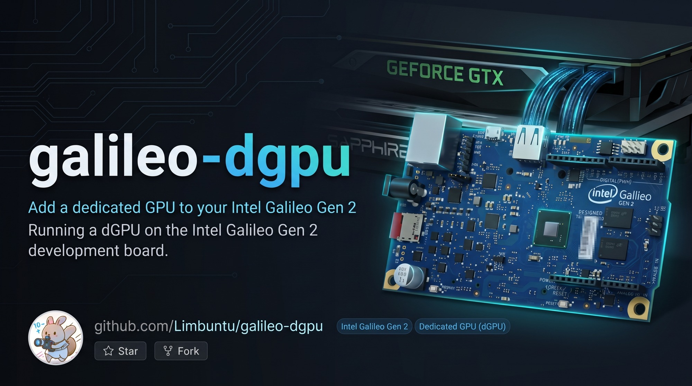
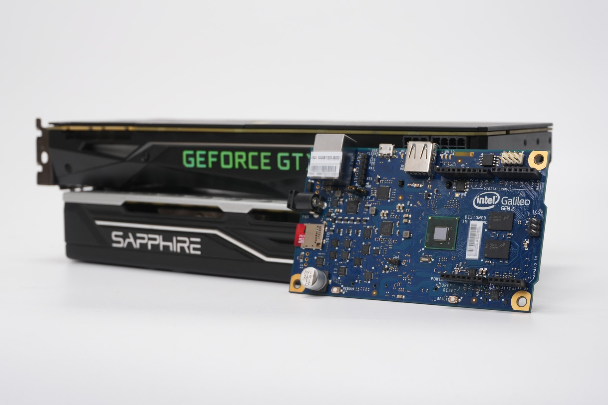
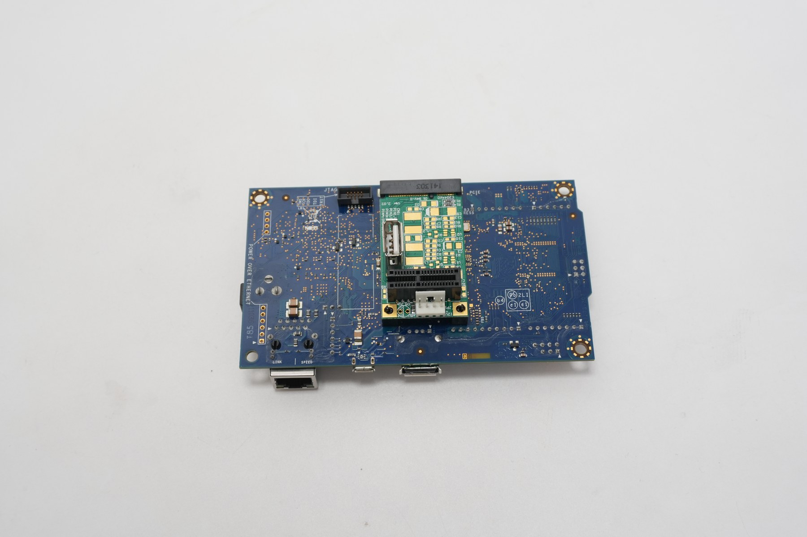
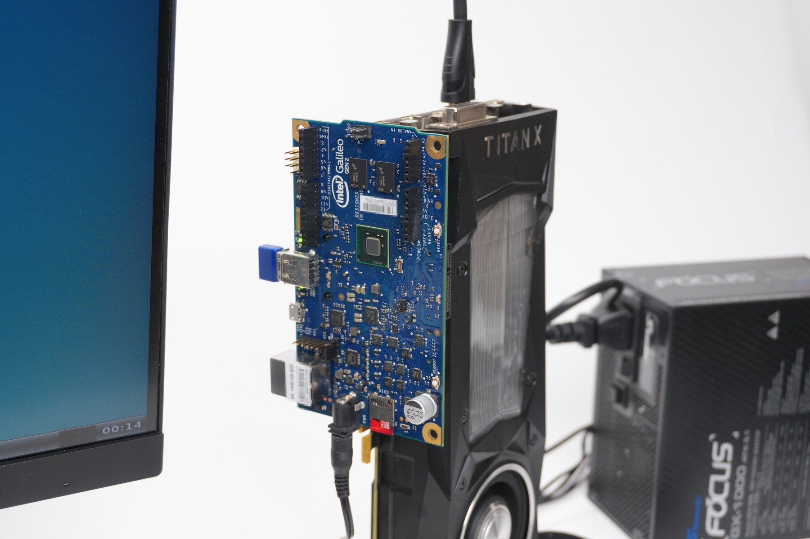
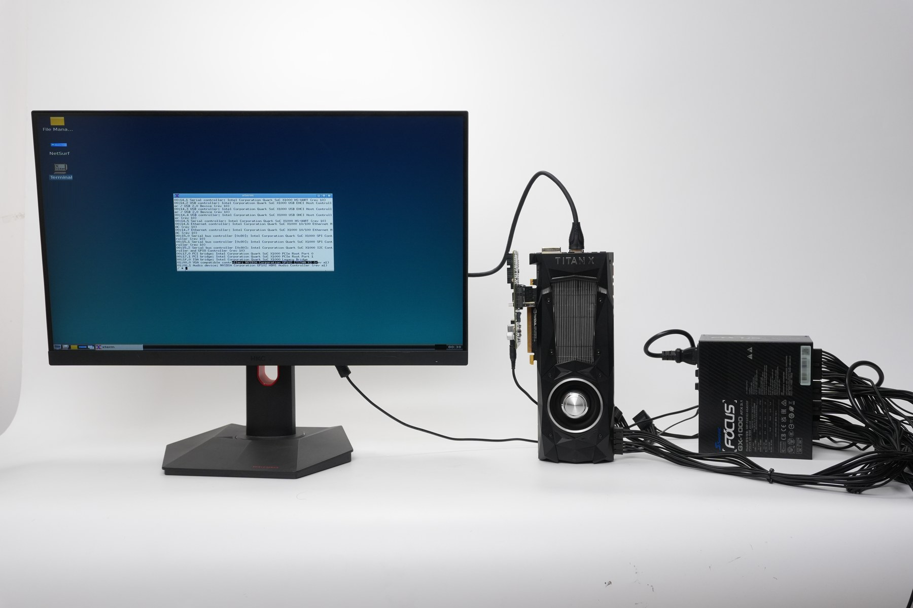
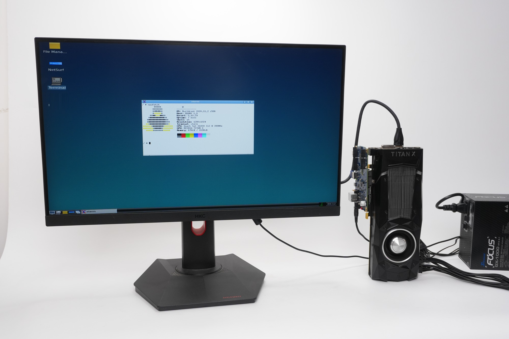

# Galileo Gen 2 — 独立显卡重制计划

[English README](README.md)

[](docs/galileo/hero.jpg)

把一块 Intel Galileo Gen 2(Quark X1000,400MHz i586,256MB 内存,无 SSE2/PAE/CMOV)
重制为一台功能齐全的 Linux 电脑:LXDE 桌面、GPU 加速、4K 视频硬解、浏览器——
由三张候选独显中的任意一张驱动显示。

## 镜像阵容

GitHub CI 构建 `desktop` 与 `workstation`;`buildserver`(Gitea,私有)保留完整
仓库,`github` 只收 `tools/push-github.sh` 过滤后的导出版本——没有第三方媒体、
没有旧镜像、没有厂商 CI,板子地址与密码一律换成占位符。

| 镜像 | 内容 | 根文件系统 |
|---|---|---|
| `galileo_desktop` | LXDE 桌面 + GPU media 栈(VA-API/UVD 4K 硬解、mpv、ffplay) | 3000M |
| `galileo_workstation` | 全功能 Linux:desktop + NetSurf + OpenTTD/Minetest + 跑分工具 + radeonsi | 3000M |

`galileo_terminal` / `galileo_browser` / `galileo_nvidia` 三个 defconfig 只作参考保留,不再构建。

## 硬件

| 主板和两张显卡 | 背面 |
|---|---|
|  |  |
| <p align="center"><b>主板、显卡与电源</b></p> | <p align="center"><b>整套工作台</b></p> |
|  |  |



## 4K 视频(A 卡,VA-API/UVD)

独显的意义就在这里:在显卡上解 4K,再直接翻页到屏上,中间不经过 X 的拷贝。

- `minplayer` —— FFmpeg VA-API 解码 → `vaExportSurfaceHandle` dmabuf → EGL
  `EGL_LINUX_DMA_BUF_EXT` → GLES2 YUV→RGB → `drmModeAddFB2` → `drmModePageFlip`。
  由 `board/intel/galileo/minplayer/build.sh` 交叉编译,`post-build.sh` 装成
  `/usr/bin/minplayer`,所以 **desktop 和 workstation 两个镜像都带**。
- `media-console` —— 板上的媒体菜单(desktop 的 xterm 里跑):窗口 ffplay、
  `mpv --hwdec=vdpau`、KMS 直出 `kms-player`、预烘焙帧 `flip-demo`、
  TCP `stream-demo`,以及两条零拷贝入口(`minplayer-demo`,含 4K30)。
  `minplayer-demo` 先停 X(DRM master 独占),结束后把桌面拉回来。
- 依赖包:`libva`、Mesa `radeonsi`+`LLVM`+`EGL`+`VDPAU`、`libvdpau`、`mpv`、
  `ffmpeg`(+`ffplay`,SDL2/X11)——`galileo_desktop_defconfig` 与
  `galileo_workstation_defconfig` 里完全一致。
- 片源放在板上 `/root/media`,不进镜像;`media-console`
  用 `ffmpeg -i` 现读时长显示在菜单上。

## 系统栈

| 层 | 组件 |
|---|---|
| 内核 | Linux 5.10.29(i586;`amdgpu`/`radeon`/`nouveau` 编译为模块,TTM 内置) |
| 基础 | Buildroot 2020.11.2、glibc、bash、dropbear SSH、DHCP |
| 显示 | Xorg 1.20 + modesetting + glamor(EGL/GBM)→ GPU 加速 2D |
| 显卡自检 | `S50desktop` 依序 insmod ttm → amdgpu → radeon → nouveau,出现 `/dev/dri/card0` 才起 X |
| Mesa | swrast + r600(HD 6450)+ radeonsi/LLVM(RX 580)+ nouveau |
| 固件 | `amdgpu/polaris10*`(裁剪)、完整 `radeon/`(Caicos 等)、`nvidia/` |
| 桌面 | openbox + lxpanel + pcmanfm(双击启动器、XDG 菜单) |
| 浏览器 | NetSurf 3.10(GTK2,HTTPS)—— 仅 workstation 镜像 |
| 声音 | ALSA(SB16 模拟 base 220h、IRQ 7、DMA 1、HDMA 5)+ MIDI |
| 工具 | links2、lspci、neofetch、wqy 中文字体、HTTP 对时 |

## 关键文件

- `configs/galileo_{desktop,workstation}_defconfig` — buildroot 包选择
- `board/intel/galileo/linux-rx580.config` — 内核配置(非 DC radeon 路径;Quark 无 SSE2)
- `board/intel/galileo/rootfs_overlay*/` — xorg.conf、启动脚本、黄金文件
- `board/intel/galileo/post-build.sh` — gconv 安装(iconv)、amdgpu 固件裁剪
- `board/intel/galileo/BENCHMARKS.md` — SuperPI / 7-Zip 跑分结果与完整测试流程

## 构建

```sh
./build.sh          # 需要 Docker + gres-builder 镜像
```

产出 docker 卷 `gres-out` 中的 `sdcard.img`,dd 刷入 SD 卡。

单独构建某一个镜像:

```sh
docker run --rm -v "$PWD":/build -v gres-out:/out -w /build \
  -e FORCE_UNSAFE_CONFIGURE=1 gres-builder sh -c '
    make O=/out/desktop BR2_DL_DIR=/out/dl galileo_desktop_defconfig &&
    make O=/out/desktop BR2_DL_DIR=/out/dl -j$(nproc)'
```

## 板子速查

- SSH:`root@<板子IP>`,密码见内部记录(本仓库不保存)
- scp 坏了(dropbear):用 `cat file | ssh ... "cat > /dest"` 管道传文件
- busybox tar 不认组合参数:`zcat f.tgz | tar -x -f - -C /`
- 无 RTC 电池:`S46timesync` 开机从 HTTP Date 头同步时间
- 时区:`/etc/TZ` = CST-8(北京时间)

## 已知坑(血泪史)

- uClibc 自称 glibc(定义 `__GLIBC__`),OpenTTD 的 execinfo 检测要加 `&& !defined(__UCLIBC__)`
- buildroot 增量构建:改 defconfig 后包不重编,必须 `rm -rf build/<pkg>-*`
- 往运行中的二进制写入会 text file busy,先杀进程再原子 `mv`
- libfm 桌面启动器双击无反应 = `/usr/share/libfm/ui/` 未部署(静默取消)
- glibc 镜像缺 gconv 模块则 iconv/g_convert 全崩(openbox 标题变 "Unnamed Window")
- XDG 菜单 XML 必须含 `<DefaultAppDirs/>`,文件名必须是 `lxde-applications.menu`
- MIT-SHM 在 `shmat` 后必须设置 `image->data = shmaddr`
